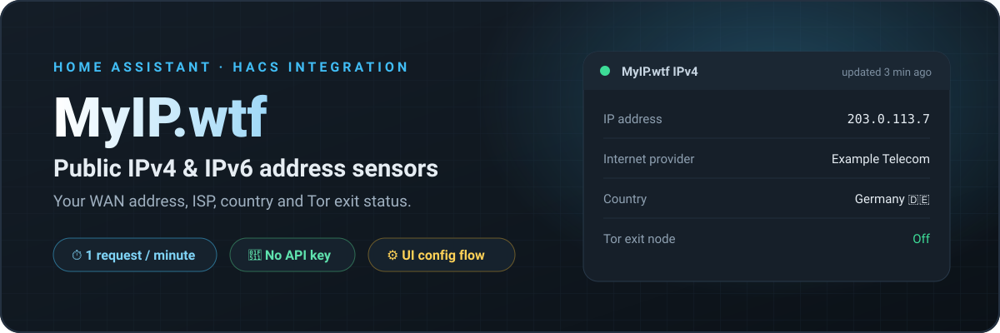
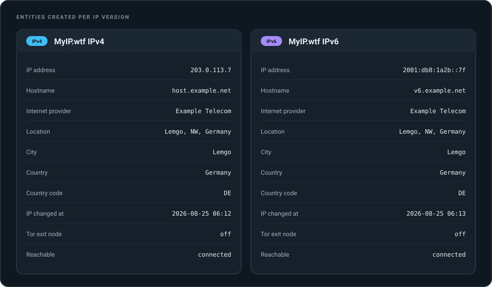
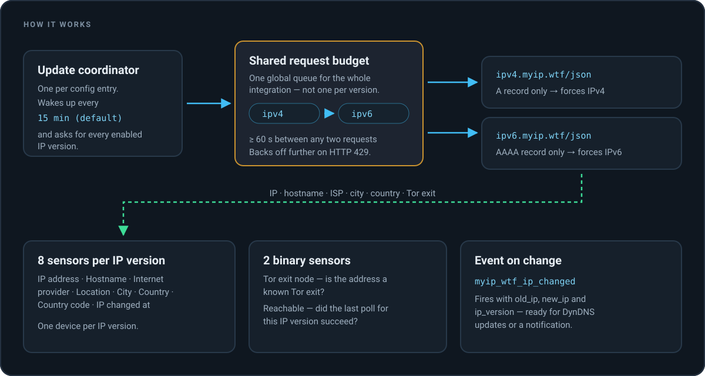
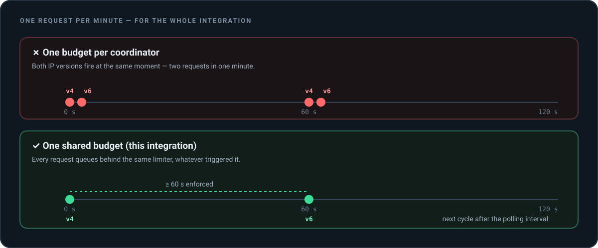
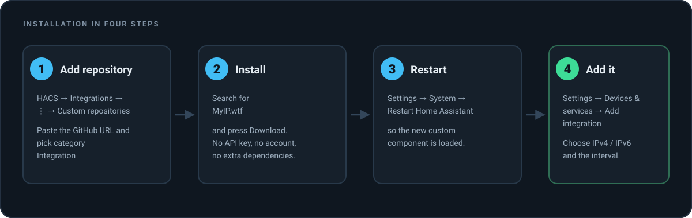
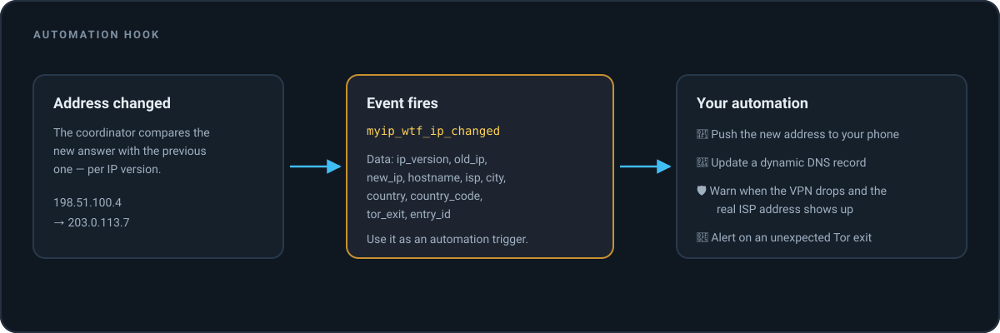
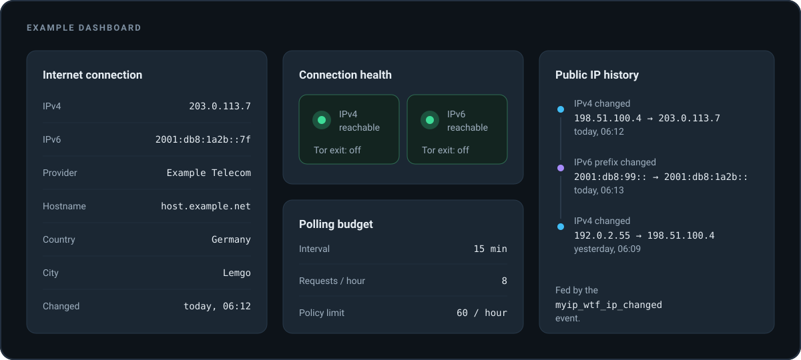

<div align="center">



# MyIP.wtf — Sensoren für die öffentliche IP-Adresse in Home Assistant

**Öffentliche IPv4- und IPv6-Adresse, Provider, Land und Tor-Exit-Status in Home Assistant überwachen.**
Eine schlanke HACS-Integration auf Basis des kostenlosen Dienstes [myip.wtf](https://myip.wtf/) — ohne API-Key, ohne Account, ohne Cloud-Anbieter dazwischen.

[](https://hacs.xyz/)
[](https://github.com/sphings79/myip-wtf-home-assistant/releases)
[](https://www.home-assistant.io/)
[](LICENSE)

[](https://my.home-assistant.io/redirect/hacs_repository/?owner=sphings79&repository=myip-wtf-home-assistant&category=integration)

[English](README.md) · **Deutsch**

</div>

---

## Inhaltsverzeichnis

- [Was die Integration macht](#was-die-integration-macht)
- [Diese Entitäten bekommst du](#diese-entitäten-bekommst-du)
- [So funktioniert es](#so-funktioniert-es)
- [Ein Request pro Minute — für die gesamte Integration](#ein-request-pro-minute--für-die-gesamte-integration)
- [Installation](#installation)
- [Konfiguration](#konfiguration)
- [Das richtige Abfrageintervall](#das-richtige-abfrageintervall)
- [Automatisierungs-Beispiele](#automatisierungs-beispiele)
- [Dashboard-Beispiel](#dashboard-beispiel)
- [Das Event `myip_wtf_ip_changed`](#das-event-myip_wtf_ip_changed)
- [Fehlersuche](#fehlersuche)
- [Häufige Fragen](#häufige-fragen)
- [Credits](#credits)
- [Haftungsausschluss](#haftungsausschluss)
- [Mitmachen](#mitmachen)
- [Lizenz](#lizenz)

---

## Was die Integration macht

Home Assistant weiß viel über dein Heimnetz — aber wenig über die Adresse, unter der dich der Rest des
Internets sieht. Genau diese Lücke schließt diese Integration: Sie fragt [myip.wtf](https://myip.wtf/),
welche **öffentliche IP-Adresse** (auch externe IP, WAN-IP oder Internet-IP genannt) dein Anschluss
gerade hat, und macht aus der Antwort ganz normale Home-Assistant-Entitäten.

Pro IP-Version bekommst du:

- die **öffentliche IPv4-** und die **öffentliche IPv6-Adresse** deines Anschlusses,
- den **Reverse-DNS-Hostnamen**, den dein Provider dafür vergibt,
- den **Internetanbieter (ISP)** hinter der Adresse,
- eine grobe **Geolokalisierung**: Stadt, Land und Ländercode,
- die Information, ob die Adresse ein bekannter **Tor-Exit-Node** ist,
- einen Zeitstempel des **letzten Adresswechsels** plus ein Event für Automatisierungen.

Typische Einsatzzwecke: ein **DynDNS-Update**, wenn der Provider eine neue Adresse zuteilt, ein
**VPN-Leak-Check** („sieht meine WAN-Adresse noch nach dem VPN-Anbieter aus?"), eine Benachrichtigung
nach der Zwangstrennung — oder einfach eine Dashboard-Karte, aus der du die Adresse für eine
Firewall-Regel abliest.

**Kein API-Key. Keine Registrierung. Keine selbst gebaute Polling-Schleife.**

## Diese Entitäten bekommst du



Jede aktivierte IP-Version wird ein eigenes **Gerät** in Home Assistant. So vermischen sich IPv4- und
IPv6-Werte weder im Dashboard noch in Automatisierungen.

| Entität | Typ | Beispielzustand | Hinweis |
| --- | --- | --- | --- |
| `sensor.myip_wtf_ipv4_ip_adresse` | Sensor | `203.0.113.7` | Deine öffentliche IPv4-Adresse |
| `sensor.myip_wtf_ipv4_hostname` | Sensor | `host.example.net` | Reverse-DNS-Name |
| `sensor.myip_wtf_ipv4_internetanbieter` | Sensor | `Example Telecom` | ISP bzw. Netzbetreiber |
| `sensor.myip_wtf_ipv4_standort` | Sensor | `Lemgo, NW, Germany` | Kombinierter Standort-String |
| `sensor.myip_wtf_ipv4_stadt` | Sensor | `Lemgo` | Grobe Städte-Schätzung |
| `sensor.myip_wtf_ipv4_land` | Sensor | `Germany` | Ländername |
| `sensor.myip_wtf_ipv4_landercode` | Sensor | `DE` | ISO 3166-1 alpha-2, diagnostisch |
| `sensor.myip_wtf_ipv4_ip_geandert_am` | Sensor | `2026-08-25T06:12:00+00:00` | Zeitstempel, übersteht Neustarts |
| `binary_sensor.myip_wtf_ipv4_tor_exit_node` | Binärsensor | `aus` | `an`, wenn die Adresse ein bekannter Tor-Exit ist |
| `binary_sensor.myip_wtf_ipv4_erreichbar` | Binärsensor | `an` | Hat die letzte Abfrage dieser IP-Version geklappt? |

Dieselben zehn Entitäten gibt es mit `ipv6` statt `ipv4`, wenn IPv6 aktiviert ist. Die konkreten
Entity-IDs hängen vom Gerätenamen ab, den du in Home Assistant vergibst — oben stehen die Standardwerte.

## So funktioniert es



Ein einzelner Update-Coordinator steuert alles:

1. In jedem Abfragezyklus fragt er jede aktivierte IP-Version ab — **immer nur eine Anfrage zur Zeit**.
2. `ipv4.myip.wtf` hat ausschließlich einen `A`-Record, `ipv6.myip.wtf` ausschließlich einen
   `AAAA`-Record. Das Betriebssystem wählt dadurch automatisch das richtige Protokoll — ganz ohne
   Socket-Tricks.
3. Die JSON-Antwort wird normalisiert (leere und Platzhalter-Werte werden zu `unbekannt`) und in die
   Entitäten geschrieben.
4. Weicht die Adresse von der vorherigen ab, feuert die Integration
   [`myip_wtf_ip_changed`](#das-event-myip_wtf_ip_changed).

## Ein Request pro Minute — für die gesamte Integration

Die [Automation Policy](https://myip.wtf/automation) von myip.wtf bittet automatisierte Clients um
**maximal einen Request pro Minute pro IP-Adresse** und erlaubt ausschließlich nicht-kommerzielle
Nutzung. Diese Integration nimmt das ernst und setzt es an genau einer Stelle durch:



- Es gibt **ein gemeinsames Anfrage-Budget** für die gesamte Integration — nicht eines pro IP-Version,
  nicht eines pro Entität und nicht eines pro Auslöser.
- Jede Anfrage — geplanter Abruf, `homeassistant.update_entity`, Prüfung im Config-Flow — stellt sich
  hinter dieses Budget an und wartet, bis seit der letzten Anfrage mindestens **60 Sekunden** vergangen
  sind.
- Eine HTTP-`429`-Antwort schiebt den nächsten erlaubten Zeitpunkt zusätzlich nach hinten und legt eine
  Reparatur-Meldung an.
- Der Config-Flow lehnt Intervalle ab, die das Budget sprengen würden: Mit beiden IP-Versionen sind
  mindestens zwei Minuten nötig, weil ein voller Zyklus zwei Anfragen kostet.

Mit dem Standardintervall von 15 Minuten und beiden IP-Versionen sendet die Integration
**8 Anfragen pro Stunde** — deutlich unter den 60, die die Policy erlauben würde.

## Installation



### HACS (empfohlen)

[](https://my.home-assistant.io/redirect/hacs_repository/?owner=sphings79&repository=myip-wtf-home-assistant&category=integration)

1. **HACS** öffnen, nach **MyIP.wtf** suchen und **Herunterladen** drücken (oder den Button oben nutzen).
2. **Home Assistant neu starten.**
3. Unter **Einstellungen → Geräte & Dienste → Integration hinzufügen** **MyIP.wtf** auswählen.

### Manuelle Installation

1. Das aktuelle Release herunterladen.
2. Den Ordner `custom_components/myip_wtf` nach `config/custom_components/` kopieren, sodass am Ende
   `config/custom_components/myip_wtf/manifest.json` existiert.
3. Home Assistant neu starten und die Integration über die Oberfläche hinzufügen.

Voraussetzungen: Home Assistant **2024.12** oder neuer sowie ausgehender HTTPS-Zugriff auf `myip.wtf`.
Zusätzliche Python-Abhängigkeiten gibt es keine.

## Konfiguration

Alles wird über die Oberfläche eingestellt, eine YAML-Konfiguration gibt es nicht. Änderungen sind
jederzeit unter **Einstellungen → Geräte & Dienste → MyIP.wtf → Konfigurieren** möglich.

| Option | Standard | Beschreibung |
| --- | --- | --- |
| Öffentliche IPv4-Adresse überwachen | an | Fragt `ipv4.myip.wtf` ab. |
| Öffentliche IPv6-Adresse überwachen | an | Fragt `ipv6.myip.wtf` ab. Ausschalten, wenn dein Anschluss kein IPv6 hat. |
| Abfrageintervall | 15 Minuten | Zeit zwischen zwei vollständigen Abfragezyklen. Minimum: eine Minute je aktivierter IP-Version. |

Wird eine IP-Version abgeschaltet, verschwinden ihr Gerät und alle zugehörigen Entitäten
beim nächsten Neuladen — sie bleiben nicht als „nicht verfügbar" stehen. Sollte doch einmal
ein Gerät übrig bleiben, lässt es sich über **Löschen** auf der Geräteseite entfernen.

Beim Einrichten prüft die Integration genau **eine** IP-Version, um zu sehen, ob der Dienst antwortet.
Eine zweite Prüfung müsste auf den gemeinsamen Anfrage-Slot warten und den Dialog blockieren — die
andere Version wird deshalb erst beim ersten regulären Abruf verifiziert.

## Das richtige Abfrageintervall

| Intervall | IP-Versionen | Anfragen pro Stunde | Geeignet für |
| --- | --- | --- | --- |
| 2 Min. | IPv4 + IPv6 | 60 | Das absolute Maximum der Policy — nur wenn wirklich nötig |
| 5 Min. | IPv4 + IPv6 | 24 | Anschlüsse mit häufigen Zwangstrennungen |
| **15 Min.** | IPv4 + IPv6 | **8** | **Standard — für fast alle passend** |
| 30 Min. | nur IPv4 | 2 | Statische oder selten wechselnde Adressen |
| 60 Min. | nur IPv4 | 1 | Geschäftsanschlüsse mit fester IP |

Öffentliche IP-Adressen wechseln selten — meist beim Router-Neustart oder bei der nächtlichen
Zwangstrennung. Häufigeres Abfragen verbrennt vor allem fremde Bandbreite. Wenn du sofort reagieren
musst, stoße den Abruf per Automatisierung mit `homeassistant.update_entity` an, sobald dein Router
eine neue Verbindung meldet — auch dieser Aufruf respektiert das gemeinsame Budget.

## Automatisierungs-Beispiele



**Benachrichtigung bei neuer öffentlicher IP-Adresse**

```yaml
automation:
  - alias: Öffentliche IP hat sich geändert
    triggers:
      - trigger: event
        event_type: myip_wtf_ip_changed
    actions:
      - action: notify.mobile_app_handy
        data:
          title: "Neue öffentliche {{ trigger.event.data.ip_version | upper }}-Adresse"
          message: >-
            {{ trigger.event.data.old_ip }} → {{ trigger.event.data.new_ip }}
            ({{ trigger.event.data.isp }})
```

**DynDNS-Eintrag aktualisieren, nur bei IPv4**

```yaml
automation:
  - alias: DynDNS bei IPv4-Wechsel aktualisieren
    triggers:
      - trigger: event
        event_type: myip_wtf_ip_changed
        event_data:
          ip_version: ipv4
    actions:
      - action: rest_command.update_dyndns
        data:
          ip: "{{ trigger.event.data.new_ip }}"
```

**Warnen, wenn das VPN abbricht und die echte Provider-Adresse auftaucht**

```yaml
automation:
  - alias: VPN-Leak-Warnung
    triggers:
      - trigger: state
        entity_id: sensor.myip_wtf_ipv4_internetanbieter
    conditions:
      - condition: template
        value_template: "{{ trigger.to_state.state == 'Example Telecom' }}"
    actions:
      - action: persistent_notification.create
        data:
          title: VPN scheint ausgefallen zu sein
          message: >-
            Home Assistant spricht gerade als
            {{ states('sensor.myip_wtf_ipv4_ip_adresse') }} mit dem Internet.
```

**Alarm bei unerwartetem Tor-Exit-Node**

```yaml
automation:
  - alias: Traffic verlässt das Netz über Tor
    triggers:
      - trigger: state
        entity_id: binary_sensor.myip_wtf_ipv4_tor_exit_node
        to: "on"
    actions:
      - action: notify.persistent_notification
        data:
          message: Die öffentliche IPv4-Adresse ist ein bekannter Tor-Exit-Node.
```

## Dashboard-Beispiel



```yaml
type: entities
title: Internetverbindung
entities:
  - entity: sensor.myip_wtf_ipv4_ip_adresse
    name: IPv4
  - entity: sensor.myip_wtf_ipv6_ip_adresse
    name: IPv6
  - entity: sensor.myip_wtf_ipv4_internetanbieter
    name: Anbieter
  - entity: sensor.myip_wtf_ipv4_hostname
    name: Hostname
  - entity: sensor.myip_wtf_ipv4_land
    name: Land
  - entity: sensor.myip_wtf_ipv4_stadt
    name: Stadt
  - entity: sensor.myip_wtf_ipv4_ip_geandert_am
    name: Geändert
  - entity: binary_sensor.myip_wtf_ipv4_tor_exit_node
    name: Tor-Exit-Node
```

## Das Event `myip_wtf_ip_changed`

Wird pro IP-Version einmal ausgelöst, sobald sich die Adresse gegenüber der vorherigen Abfrage
unterscheidet. Beim allerersten erfolgreichen Abruf nach einem Neustart feuert es **nicht** — ein
Neustart von Home Assistant löst deine Automatisierungen also nie versehentlich aus.

| Feld | Beispiel | Beschreibung |
| --- | --- | --- |
| `ip_version` | `ipv4` | Welche Version sich geändert hat — `ipv4` oder `ipv6` |
| `old_ip` | `198.51.100.4` | Die vorher gesehene Adresse |
| `new_ip` | `203.0.113.7` | Die neue Adresse |
| `hostname` | `host.example.net` | Reverse-DNS der neuen Adresse |
| `isp` | `Example Telecom` | Anbieter der neuen Adresse |
| `city` / `country` / `country_code` | `Lemgo` / `Germany` / `DE` | Geolokalisierung der neuen Adresse |
| `tor_exit` | `false` | Ist die neue Adresse ein bekannter Tor-Exit-Node? |
| `entry_id` | `01J…` | Config-Eintrag, der das Event gefeuert hat |

## Fehlersuche

**Die IPv6-Entitäten bleiben nicht verfügbar.** Viele Anschlüsse haben immer noch kein funktionierendes
IPv6. Nach drei fehlgeschlagenen Zyklen legt die Integration eine Reparatur-Meldung an — schalte IPv6
in den Optionen ab, um die fehlschlagenden Anfragen zu beenden.

**„myip.wtf drosselt diesen Host".** Der Dienst hat mit HTTP 429 geantwortet. Erhöhe das
Abfrageintervall und prüfe, ob am selben Anschluss noch etwas anderes myip.wtf abfragt — eine zweite
Home-Assistant-Instanz, ein Skript, ein Router-Add-on. Das Limit zählt pro öffentlicher IP-Adresse,
nicht pro Anwendung.

**Die Adresse stimmt nicht oder die Stadt ist falsch.** Angezeigt wird die Adresse, die der Dienst
sieht — also die, über die dein Verkehr tatsächlich hinausgeht: Mit aktivem VPN oder Proxy ist das die
Adresse des VPN, nicht die deines Anschlusses. Die Geolokalisierung stammt aus einer IP-Datenbank und
ist eine grobe Schätzung, kein GPS.

**Debug-Logging aktivieren:**

```yaml
logger:
  default: warning
  logs:
    custom_components.myip_wtf: debug
```

Auf der Integrationsseite gibt es außerdem **Diagnose herunterladen**. IP-Adresse, Hostname und Stadt
werden vor dem Schreiben geschwärzt — die Datei kann also bedenkenlos an ein Issue angehängt werden.

## Häufige Fragen

**Brauche ich einen API-Key oder ein Konto?**
Nein. myip.wtf ist ein kostenloser Dienst ohne Registrierung. Die Integration schickt ein einfaches
HTTPS-`GET` und identifiziert sich mit einem sprechenden `User-Agent`.

**Darf ich das kommerziell nutzen?**
Nein. Die [Automation Policy von myip.wtf](https://myip.wtf/automation) verbietet kommerzielle Nutzung
ausdrücklich. Hausautomatisierung zu Hause ist in Ordnung, ein betriebliches Monitoring-System nicht.

**Wie unterscheidet sich das von den eingebauten IP-Integrationen?**
Die Core-Integration `dnsip` löst einen DNS-Namen zu einer Adresse auf, `ipify`-artige Dienste liefern
nur die nackte Adresse. myip.wtf liefert Hostname, Provider, Geolokalisierung und Tor-Exit-Erkennung in
derselben Antwort — und diese Integration ergänzt Wechsel-Event, Geräte pro IP-Version und das
gemeinsame Rate-Limit.

**Funktioniert das hinter CGNAT oder einem VPN?**
Ja, und genau das ist der Punkt: Gemeldet wird die Adresse, die das Internet tatsächlich sieht — hinter
CGNAT die geteilte Adresse deines Providers, hinter einem VPN die Exit-Adresse des VPN.

**Warum dauert eine Aktualisierung manchmal eine Minute?**
Weil die zweite IP-Version auf den gemeinsamen Slot warten muss. Das ist Absicht.

**Bremst das den Start von Home Assistant?**
Nein. Der erste Abruf nach einem Neustart holt nur eine IP-Version; etwa eine Minute später ergänzt ein
einmaliger Nachzügler-Abruf den Rest.

**Kann ich zwei Instanzen betreiben?**
Nein — die Integration ist bewusst auf einen einzigen Config-Eintrag beschränkt, damit das
Anfrage-Budget nicht versehentlich umgangen wird.

**Wird meine IP-Adresse irgendwo anders hingeschickt?**
Nein. Die einzige ausgehende Verbindung geht zu myip.wtf — und der Dienst sieht deine Adresse
zwangsläufig, weil er sie ja zurückmeldet. Siehe die
[Privacy Policy](https://myip.wtf/privacy) des Dienstes.

## Credits

**Diese Integration ist nicht der Dienst.** Sämtliche Daten stammen von einem kostenlosen Dienst, den
andere betreiben — und ihnen gebührt die Anerkennung dafür:

- **[myip.wtf](https://myip.wtf/) / [wtfismyip.com](https://wtfismyip.com/)** — der Dienst für
  öffentliche IP-Adressen, aus dem diese Integration liest. Keine Werbung, keine Tracker, kein
  CloudFlare, mit IPv6-Unterstützung und Tor-Exit-Erkennung, kostenlos für die Community
  bereitgestellt.
- Der Quellcode ist öffentlich:
  **[codeberg.org/wtfismyip/wtfismyip](https://codeberg.org/wtfismyip/wtfismyip)**.
- Die [Automation Policy](https://myip.wtf/automation) und die
  [Privacy Policy](https://myip.wtf/privacy) haben das Design dieser Integration geprägt.

Wenn dir der Dienst nützt: **[spende an die Betreiber](https://myip.wtf/donate)** — sie finanzieren
ihn ohne Werbeeinnahmen.

Dank geht außerdem an die Home-Assistant- und HACS-Community für die Muster, denen dieses Projekt folgt.

## Haftungsausschluss

Dies ist eine **inoffizielle, von der Community gebaute** Integration. Sie steht in keiner Verbindung
zu den Betreibern von myip.wtf / wtfismyip.com und wird weder von ihnen noch vom Home-Assistant-Projekt
unterstützt oder betrieben. Der Dienst wird ohne Zusagen zu Verfügbarkeit oder Zuverlässigkeit
bereitgestellt — das gilt damit auch für diese Integration. Nutzung auf eigenes Risiko, und bitte
innerhalb der Automation Policy des Dienstes.

Die Original-API verwendet bewusst derbe Feldnamen. Die Integration bildet sie auf neutrale
Entitätsnamen ab — in deiner Home-Assistant-Instanz taucht davon nichts auf.

## Mitmachen

Issues und Pull Requests sind willkommen. Zwei Dinge bitte im Blick behalten:

- Jede Änderung muss innerhalb von **einem Request pro Minute insgesamt** bleiben.
- Vor einem PR die Prüfungen laufen lassen:

```bash
pip install homeassistant pytest pytest-asyncio ruff && ruff check . && pytest
```

Probleme mit dem Dienst myip.wtf selbst (Ausfälle, falsche Geolokalisierung) gehören
[stromaufwärts](https://codeberg.org/wtfismyip/wtfismyip), nicht hierher.

---

## Sponsor this project

Diese Tools entstehen in meiner Freizeit und bleiben kostenlos, quelloffen und cloudfrei.
Wenn dir eines davon einen Nachmittag gespart hat, kannst du mir [einen Kaffee ausgeben](https://buymeacoffee.com/sphings).

[](https://buymeacoffee.com/sphings)

## Lizenz

[MIT](LICENSE) © Dennis (@sphings79)

---

<div align="center">

<sub>

**Schlagwörter:** Home Assistant öffentliche IP Sensor · externe IP-Adresse Home Assistant · WAN-IP
Sensor · HACS Custom Integration · IPv4- und IPv6-Überwachung · Provider-Sensor · DynDNS-Auslöser ·
Tor-Exit-Node-Erkennung · myip.wtf · wtfismyip

</sub>

</div>
